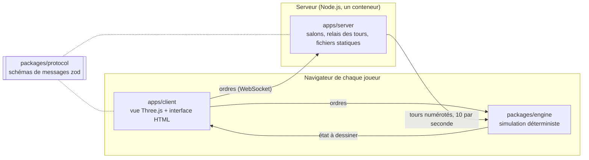

<p align="center">
  <a href="https://nclsmgr.com/frontfall/">
    <picture>
      <source media="(prefers-color-scheme: dark)" srcset="docs/assets/banner-dark.svg">
      
    </picture>
  </a>
</p>

# Frontfall

**Un jeu de stratégie territoriale multijoueur en temps réel, dans le navigateur, sur un monde sans bord.**

[](https://nclsmgr.com/frontfall/)
[](https://github.com/nic0lasm/frontfall/releases/latest)
[](https://github.com/nic0lasm/frontfall/actions/workflows/ci.yml)
[](https://github.com/nic0lasm/frontfall/actions/workflows/codeql.yml)
[](https://scorecard.dev/viewer/?uri=github.com/nic0lasm/frontfall)
[](vitest.config.ts)
[](#en-un-coup-dœil)
[](LICENSE)

[English version](README.md)

## Jouer

La version en cours tourne sur **[nclsmgr.com/frontfall](https://nclsmgr.com/frontfall/)**, sans compte ni installation. Chaque push sur `main` y est déployé en quelques minutes.

Jouez en solo contre des bots, ou en ligne entre amis par un lien d'invitation ou dans une partie publique. Treize cartes : Monde, Europe, Amériques, Afrique et Asie, tirées de Natural Earth, les villes de Paris et de Lyon, et six cartes rapides, Île, Détroit, Anneau, Continents, Pangée et Escarmouche. Les navires portent les troupes par la mer, par les canaux de Panama et de Suez. Construisez villes, forts, ports, silos à missiles et défenses aériennes, commercez par la mer, envoyez des navires de guerre en patrouille, alliez-vous, trahissez, envoyez dons et messages rapides, ou jouez en équipes. Une partie privée peut se passer de n'importe quelle construction, et l'écran de fin enregistre la partie pour la revoir. L'interface est en français et en anglais.

<p align="center">
  
</p>

<p align="center">
  
</p>

Nouveau ? [Présentation et comment jouer](https://nclsmgr.com/frontfall/about.fr.html), ou appuyez sur H en partie.

## Navigateurs pris en charge

Chrome et Edge 111, Firefox 114 (121 pour l'affichage complet), Safari et iOS 16.4 ou plus récents, avec WebGL 2. La CI joue une partie dans Chromium, Firefox et WebKit à chaque changement. [Le tableau complet](docs/browsers.md) (en anglais) dit ce que demande chaque version et ce qui n'est qu'une hypothèse. Un navigateur qui ne peut pas faire tourner le jeu le dit, au lieu d'afficher une page blanche.

Frontfall est en bêta jusqu'à la v1.0 : règles, équilibrage et visuels changent encore. [La feuille de route](#feuille-de-route) dit ce qui vient ensuite.

## En un coup d'œil

|                   |                                                                                                                                                                                                                                                                                                                                                                                                                                                                                                                                                                                                       |
| ----------------- | ----------------------------------------------------------------------------------------------------------------------------------------------------------------------------------------------------------------------------------------------------------------------------------------------------------------------------------------------------------------------------------------------------------------------------------------------------------------------------------------------------------------------------------------------------------------------------------------------------- |
| **Le jeu**        | Partir d'une case, dépasser ses voisins, tenir la carte. Parties courtes, sans installation.                                                                                                                                                                                                                                                                                                                                                                                                                                                                                                          |
| **La différence** | La carte du Monde boucle d'est en ouest, et la v1.0 la pose sur un globe 3D. Aucun bord où se cacher.                                                                                                                                                                                                                                                                                                                                                                                                                                                                                                 |
| **État**          | Bêta. La [v0.9.4](https://github.com/nic0lasm/frontfall/releases/tag/v0.9.4) est publiée, avec un rythme plus calme, des nations faciles alliées, de vrais disques de missile, la Mosquée de Cyrus et la partie rapide sur Lyon, après les v0.9.3, v0.9.2 et les nations qui font des alliances, les niveaux plus doux et le compte unique de la v0.9.1 : la carte en vitrail, de vrais navires et des bâtiments en figurines, des missiles qu'on suit du regard, des explosions en volume, des nations qui ont de la mémoire et la parole, et un serveur en France ; le globe 3D arrive juste après. |
| **Jouer**         | [nclsmgr.com/frontfall](https://nclsmgr.com/frontfall/), ou votre propre serveur avec une image Docker.                                                                                                                                                                                                                                                                                                                                                                                                                                                                                               |
| **Prérequis**     | Un navigateur récent compatible WebGL 2 ([lesquels](docs/browsers.md)). Un ordinateur reste le plus confortable.                                                                                                                                                                                                                                                                                                                                                                                                                                                                                      |
| **Licence**       | MIT : libre d'y jouer, de le forker et de l'héberger.                                                                                                                                                                                                                                                                                                                                                                                                                                                                                                                                                 |

## Feuille de route

Le développement avance par versions jouables. Chacune se termine par quelque chose de jouable sur le serveur public. Toutes les versions avant la v1.0 sont des bêtas ; la v1.0 est le jeu complet sur le globe 3D.

| Version | Objectif                                                                                                  | État     |
| ------- | --------------------------------------------------------------------------------------------------------- | -------- |
| M0      | Fondations et spécification : squelette du moteur, relais des tours, CI, déploiement                      | Terminé  |
| v0.1    | Partie solo dans le navigateur contre des bots, sur une carte de la Terre                                 | Terminé  |
| v0.2    | En ligne entre amis : liens d'invitation, parties publiques, huit cartes, désyncs                         | Terminé  |
| v0.3    | Jeu plus riche : villes et forts, alliances, nations, bots, surveillance                                  | Terminé  |
| v0.4    | Mer et missiles : replays, équipes, ports et commerce, navires de guerre, missiles                        | Terminé  |
| v0.4.x  | Correctifs : les bugs trouvés depuis la v0.4.0                                                            | Fait     |
| v0.5    | En service : parties publiques modérées, mesures d'usage conservées                                       | Fait     |
| v0.6    | Téléphones et confort : une partie entière au doigt, un seul panneau de réglages                          | Fait     |
| v0.7    | Look et ambiance : refonte graphique, une icône reconnaissable par bâtiment, sons, tutoriel               | Fait     |
| v0.8    | Règles propres : fronts qui s'effondrent, doctrines et objectifs, depuis un menu à part                   | Fait     |
| v0.9    | Fluide sur un portable modeste et un téléphone, clics rapides, sons et musique, serveur éprouvé en charge | Fait     |
| v0.9.x  | Globe 3D, et bascule entre carte et globe en cours de partie                                              | À suivre |
| v0.10   | Cartes de la communauté : cartes et traductions des joueurs, liens de replay, spectateurs                 | Prévu    |
| v1.0    | Le jeu complet sur le globe 3D, fin de la bêta                                                            | Prévu    |

Le périmètre et les critères « jouable » de chaque version sont dans [docs/roadmap.md](docs/roadmap.md) (en anglais). Le travail ouvert est suivi dans les [milestones](https://github.com/nic0lasm/frontfall/milestones).

## Comment ça marche

Chaque client fait tourner la même simulation. Le serveur ne calcule jamais la partie : il recueille les ordres de chaque joueur, les numérote en tours dix fois par seconde et envoie les mêmes tours à tout le monde. Mêmes entrées sur un moteur déterministe, même partie, pour une fraction de la bande passante qu'exigerait l'envoi de l'état.



| Choix                       | Pourquoi                                                                                                       |
| --------------------------- | -------------------------------------------------------------------------------------------------------------- |
| TypeScript strict           | Un seul langage pour le moteur, le client et le serveur                                                        |
| Lockstep déterministe       | Calcul entier et générateur à graine ; les règles de lint interdisent l'horloge et `Math.random`               |
| Grille du monde cylindrique | Pas de bord gauche ni droit dès aujourd'hui ; le globe change la projection, pas les règles                    |
| Three.js                    | Rendu WebGL qui passe de la carte plate au globe                                                               |
| Schémas zod                 | Chaque message est validé à l'arrivée, des deux côtés                                                          |
| Un seul petit conteneur     | Système de fichiers en lecture seule, utilisateur non root, image multi-arch analysée avant chaque publication |

Chaque choix est justifié dans une fiche de décision d'architecture, dans [docs/adr](docs/adr/), et les budgets de durée de tick, de temps de rendu et de mémoire imposés au moteur et au rendu sont dans [docs/performance.md](docs/performance.md) (en anglais). Les messages échangés sur la WebSocket sont décrits dans [docs/protocol.md](docs/protocol.md) (en anglais). Les cartes sont générées à partir des données [Natural Earth](https://www.naturalearthdata.com/), du domaine public, par `pnpm maps` ([docs/maps.md](docs/maps.md), en anglais), au format décrit dans [docs/map-format.md](docs/map-format.md) (en anglais).

## Lancer en local

Prérequis : Node.js 24 LTS et pnpm 10, fourni par `corepack enable`.

```sh
git clone https://github.com/nic0lasm/frontfall.git
cd frontfall
corepack enable
pnpm install
pnpm dev        # client sur http://localhost:5173, serveur sur :8080
```

| Commande             | Rôle                                                      |
| -------------------- | --------------------------------------------------------- |
| `pnpm test`          | Tests unitaires (Vitest)                                  |
| `pnpm test:coverage` | Tests avec couverture ; la CI échoue sous 90 % des lignes |
| `pnpm lint`          | ESLint avec règles typées                                 |
| `pnpm typecheck`     | TypeScript en mode strict, pour chaque paquet             |
| `pnpm build`         | Client de production et serveur empaqueté                 |

### Héberger son propre serveur

L'image publiée sert le client et le relais des tours sur un seul port :

```sh
docker run --rm -p 8080:8080 ghcr.io/nic0lasm/frontfall:latest   # http://localhost:8080
```

Pour un serveur qui reste en ligne, `docker compose up -d` avec le [`compose.yaml`](compose.yaml) du dépôt garde les statistiques d'usage dans un volume et redémarre après un reboot. [docs/self-hosting.md](docs/self-hosting.md) (en anglais) décrit l'installation, le HTTPS derrière Caddy ou nginx, à la racine d'un domaine ou sous un chemin comme `/frontfall`, et comment vérifier que tout marche.

## Contribuer

Frontfall se construit en public et toute contribution est bienvenue, quelle que soit sa taille : code, cartes, retours d'équilibrage, traductions, rapports de bug.

1. **Jouez à la version en cours** et [signalez ce qui casse](https://github.com/nic0lasm/frontfall/issues/new/choose).
2. **Choisissez une première tâche** parmi les issues marquées [`good first issue`](https://github.com/nic0lasm/frontfall/labels/good%20first%20issue) et laissez un commentaire pour que personne ne fasse le travail en double.
3. **Discutez avant de construire** quoi que ce soit d'important dans les [Discussions](https://github.com/nic0lasm/frontfall/discussions), catégorie Ideas.
4. **Ouvrez une pull request** en suivant [CONTRIBUTING.md](CONTRIBUTING.md) (en anglais). La CI lance les mêmes vérifications que `pnpm test:coverage`, `pnpm lint` et `pnpm build`.

Les failles de sécurité se signalent en privé, comme l'explique [SECURITY.md](SECURITY.md). Chaque participant respecte le [code de conduite](CODE_OF_CONDUCT.md).

## Communauté

- [Discussions](https://github.com/nic0lasm/frontfall/discussions) : questions, idées, propositions de cartes, notes de développement. Le français y est bienvenu.
- [Releases](https://github.com/nic0lasm/frontfall/releases) : ce qui change à chaque version, en clair. Suivez le dépôt avec « Watch > Custom > Releases » pour être prévenu.
- [CHANGELOG.md](CHANGELOG.md) : chaque changement fusionné, du plus récent au plus ancien.

Si la direction vous plaît, une étoile aide d'autres joueurs à trouver le projet.

## Ce que le jeu enregistre

Le jeu compte la façon dont on y joue, jamais qui y joue : quelles cartes et quels modes, la durée des parties et leur issue, téléphone ou ordinateur, la langue, les erreurs qui ont gâché une partie, et le pouce levé ou baissé que vous pouvez donner à la fin. Ni pseudo, ni adresse, ni cookie : votre navigateur prévient le serveur du jeu lui-même, qui ne garde que des totaux par jour, publiés sur [`/api/stats`](https://nclsmgr.com/frontfall/api/stats). Un navigateur réglé sur « Ne pas me pister » (Do Not Track) ou Global Privacy Control n'envoie rien. Chaque champ est détaillé dans [docs/privacy.md](docs/privacy.md) (en anglais).

## Inspiration et mentions légales

Frontfall est un jeu indépendant inspiré d'OpenFront. Il n'est ni affilié à OpenFront ni approuvé par OpenFront. Il ne contient aucun code ni aucun asset d'OpenFront. Les règles du jeu sont écrites de zéro dans [docs/rules.md](docs/rules.md) (en anglais), selon une [politique de salle blanche](docs/clean-room.md) vérifiée par la CI, et chaque bibliothèque ou jeu de données tiers est listé dans [CREDITS.md](CREDITS.md) avec sa licence.

## Licence

[MIT](LICENSE) © 2026 Nicolas Maigre. Le nom et le logo Frontfall ne sont pas couverts par la licence du code ; leur usage est décrit dans le [guide de marque](docs/brand.md) (en anglais).
