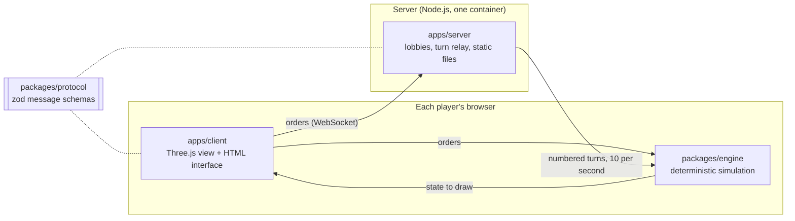

<p align="center">
  <a href="https://nclsmgr.com/frontfall/">
    <picture>
      <source media="(prefers-color-scheme: dark)" srcset="docs/assets/banner-dark.svg">
      
    </picture>
  </a>
</p>

# Frontfall

**A real-time multiplayer territorial strategy game, played in the browser on a world with no edges.**

[](https://nclsmgr.com/frontfall/)
[](https://github.com/nic0lasm/frontfall/releases/latest)
[](https://github.com/nic0lasm/frontfall/actions/workflows/ci.yml)
[](https://github.com/nic0lasm/frontfall/actions/workflows/codeql.yml)
[](https://scorecard.dev/viewer/?uri=github.com/nic0lasm/frontfall)
[](vitest.config.ts)
[](#at-a-glance)
[](LICENSE)

[Version française](README.fr.md)

## Play now

The current build runs at **[nclsmgr.com/frontfall](https://nclsmgr.com/frontfall/)**, no account and no install. Every push to `main` is deployed there within minutes.

Play solo against bots, or online with friends through an invitation link or in a public game. Eleven maps: World, Europe, the Americas, Africa and Asia drawn from Natural Earth, and six quick maps, Island, Strait, Ring, Continents, Pangaea and Skirmish. Ships carry troops across the sea, through the Panama and Suez canals. Build cities, forts, ports, missile silos and air defenses, trade by sea, send warships to patrol, ally, betray, send gifts and quick messages, or play in teams. A private game can leave out any structure, and the end screen saves the game to watch it again. The interface is in English and French.

<p align="center">
  
</p>

<p align="center">
  
</p>

New here? [About the game and how to play](https://nclsmgr.com/frontfall/about.html), or press H in a game.

## Supported browsers

Chrome and Edge 111, Firefox 114 (121 for the full look), Safari and iOS 16.4 or newer, with WebGL 2. CI plays the game in Chromium, Firefox and WebKit on every change. [The full table](docs/browsers.md) says what each version needs and what has only been assumed. A browser that cannot run the game says so instead of showing a blank page.

Frontfall is in beta until v1.0: rules, balance and visuals still change. [The roadmap](#roadmap) says what comes next.

## At a glance

|                  |                                                                                                                                                                                                                                                                                                                                                                                                      |
| ---------------- | ---------------------------------------------------------------------------------------------------------------------------------------------------------------------------------------------------------------------------------------------------------------------------------------------------------------------------------------------------------------------------------------------------- |
| **What it is**   | Spread from a single tile, outgrow your neighbours, hold the map. Short rounds, no install.                                                                                                                                                                                                                                                                                                          |
| **The twist**    | The World map wraps east to west, and v1.0 puts it on a 3D globe. There is no edge to hide behind.                                                                                                                                                                                                                                                                                                   |
| **Status**       | Beta. [v0.9.2](https://github.com/nic0lasm/frontfall/releases/tag/v0.9.2) is out, on top of v0.9.1's nations that make alliances, easier levels and one account for every way to sign in: the map as stained glass, real ships and figurine buildings, missiles you can follow, volumetric explosions, nations with a memory and a voice, and a server in France; the 3D globe comes right after it. |
| **Play**         | [nclsmgr.com/frontfall](https://nclsmgr.com/frontfall/), or your own server with one Docker image.                                                                                                                                                                                                                                                                                                   |
| **Requirements** | A recent browser with WebGL 2 ([which ones](docs/browsers.md)). Best on a desktop or laptop.                                                                                                                                                                                                                                                                                                         |
| **License**      | MIT, free to play, fork and host.                                                                                                                                                                                                                                                                                                                                                                    |

## Roadmap

Development runs in playable versions. Each one ends with something you can play on the public server. Every version before v1.0 is a beta; v1.0 is the complete game on the 3D globe.

| Version | Goal                                                                                             | Status  |
| ------- | ------------------------------------------------------------------------------------------------ | ------- |
| M0      | Foundations and specification: engine skeleton, turn relay, CI, deployment, rules                | Done    |
| v0.1    | Solo game in the browser against bots, on a map of the Earth                                     | Done    |
| v0.2    | Online with friends: invite links, public games, eight maps, desync reports                      | Done    |
| v0.3    | Deeper game: cities and forts, alliances, nations, stronger bots, monitoring                     | Done    |
| v0.4    | Sea and missiles: replays, team games, ports and trade, warships, missiles                       | Done    |
| v0.4.x  | Fixes: the bugs found since v0.4.0                                                               | Done    |
| v0.5    | Live: moderated public games, usage counts that last                                             | Done    |
| v0.6    | Phones and comfort: a whole game by touch, one settings panel                                    | Done    |
| v0.7    | Look and feel: a full redesign, a recognisable icon for every building, sound, a tutorial        | Done    |
| v0.8    | Own rules: collapsing fronts, doctrines and objectives, from a menu of their own                 | Done    |
| v0.9    | Smooth on a modest laptop and a phone, quick clicks, sound and music, a server tested under load | Done    |
| v0.9.x  | 3D globe, and switching between map and globe during a game                                      | Next    |
| v0.10   | Community maps: maps and translations from players, replay links, spectators                     | Planned |
| v1.0    | The complete game on the 3D globe, out of beta                                                   | Planned |

The scope and "playable when" checks of each version are in [docs/roadmap.md](docs/roadmap.md). Open work is tracked in [milestones](https://github.com/nic0lasm/frontfall/milestones).

## How it works

Every client runs the same simulation. The server never computes the game: it collects each player's orders, numbers them into turns ten times per second, and sends the same turns to everyone. Identical inputs on a deterministic engine give identical games, for a fraction of the bandwidth of streaming the state.



| Choice                 | Why                                                                                 |
| ---------------------- | ----------------------------------------------------------------------------------- |
| TypeScript, strict     | One language for engine, client and server                                          |
| Deterministic lockstep | Integer maths and a seeded generator; lint rules forbid the clock and `Math.random` |
| Cylindrical world grid | No left or right edge today; the globe changes the projection, not the rules        |
| Three.js               | WebGL rendering that scales from the flat map to the globe                          |
| zod schemas            | Every message is validated on arrival, on both sides                                |
| Single small container | Read-only filesystem, non-root user, multi-arch image scanned before every release  |

Each choice is argued in an architecture decision record under [docs/adr](docs/adr/), and the tick, frame and memory budgets the engine and renderer are held to are in [docs/performance.md](docs/performance.md). The messages exchanged over the WebSocket are described in [docs/protocol.md](docs/protocol.md). Maps are generated from public-domain [Natural Earth](https://www.naturalearthdata.com/) data by `pnpm maps` ([docs/maps.md](docs/maps.md)), in the format of [docs/map-format.md](docs/map-format.md).

## Run it locally

Requirements: Node.js 24 LTS and pnpm 10, which `corepack enable` provides.

```sh
git clone https://github.com/nic0lasm/frontfall.git
cd frontfall
corepack enable
pnpm install
pnpm dev        # client on http://localhost:5173, server on :8080
```

| Command              | What it does                                      |
| -------------------- | ------------------------------------------------- |
| `pnpm test`          | Unit tests (Vitest)                               |
| `pnpm test:coverage` | Tests with coverage; CI fails below 90 % of lines |
| `pnpm lint`          | ESLint with type-aware rules                      |
| `pnpm typecheck`     | TypeScript in strict mode, every package          |
| `pnpm build`         | Production client and bundled server              |

### Host your own server

The published image serves the client and the turn relay on one port:

```sh
docker run --rm -p 8080:8080 ghcr.io/nic0lasm/frontfall:latest   # http://localhost:8080
```

For a server that stays up, `docker compose up -d` with the [`compose.yaml`](compose.yaml) of this repository keeps the usage counts in a volume and restarts after a reboot. [docs/self-hosting.md](docs/self-hosting.md) explains the setup, HTTPS behind Caddy or nginx, at the root of a domain or under a path such as `/frontfall`, and how to check that it works.

## How to contribute

Frontfall is built in the open and contributions of every size are welcome: code, maps, balance feedback, translations, bug reports.

1. **Play the current build** and [report what breaks](https://github.com/nic0lasm/frontfall/issues/new/choose).
2. **Pick a starter task** among the issues labelled [`good first issue`](https://github.com/nic0lasm/frontfall/labels/good%20first%20issue) and leave a comment so nobody duplicates the work.
3. **Discuss before building** anything large in [Discussions](https://github.com/nic0lasm/frontfall/discussions), under Ideas.
4. **Open a pull request** following [CONTRIBUTING.md](CONTRIBUTING.md). CI runs the same checks as `pnpm test:coverage`, `pnpm lint` and `pnpm build`.

Security issues are reported privately, as described in [SECURITY.md](SECURITY.md). Everyone taking part follows the [Code of Conduct](CODE_OF_CONDUCT.md).

## Community

- [Discussions](https://github.com/nic0lasm/frontfall/discussions): questions, ideas, map proposals, development notes. French is welcome too.
- [Releases](https://github.com/nic0lasm/frontfall/releases): what changed in each version, in plain words. Watch the repository with "Custom > Releases" to be notified.
- [CHANGELOG.md](CHANGELOG.md): every merged change, newest first.

If you like where this is going, a star helps other players find the project.

## What the game records

The game counts how it is played, never who plays: which maps and modes, how long games last and how they end, phone or computer, which language, errors that broke a game, and the thumbs up or down you can give at the end. No name, no address, no cookie: your browser tells the game's own server, which only keeps totals per day, published at [`/api/stats`](https://nclsmgr.com/frontfall/api/stats). A browser set to Do Not Track or Global Privacy Control sends nothing. Every field is listed in [docs/privacy.md](docs/privacy.md).

## Inspiration and legal

Frontfall is an independent game inspired by OpenFront. It is not affiliated with or endorsed by OpenFront. It contains no code or assets from OpenFront. Game rules are written from scratch in [docs/rules.md](docs/rules.md) under a [clean-room policy](docs/clean-room.md) that CI enforces, and every third-party library or dataset is listed in [CREDITS.md](CREDITS.md) with its license.

## License

[MIT](LICENSE) © 2026 Nicolas Maigre. The Frontfall name and logo are not covered by the code license; how to use them is described in the [brand guide](docs/brand.md).
