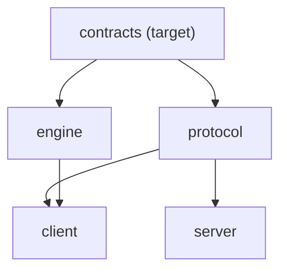
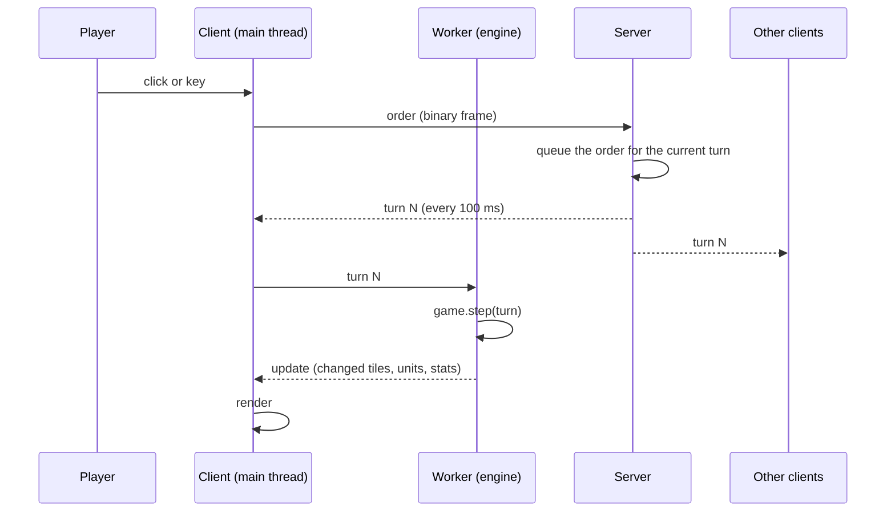
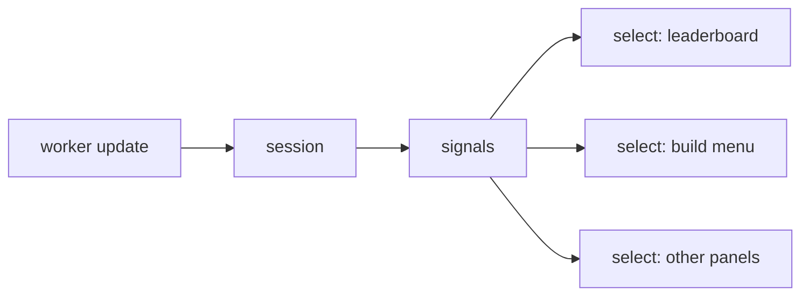

# Architecture guide

This page maps the repository, shows how the layers depend on each other, follows the data from a click to a screen, and gives recipes for the common changes. The decisions behind it are the [architecture decision records](adr/).

Some parts describe code that exists today. Others describe the target of the proposed records [0006](adr/0006-contracts-package.md) to [0014](adr/0014-enforced-boundaries.md), which later pull requests implement. Each such part is marked **Target**. Until its pull request is merged, follow the **Today** text.

## Repo map

| Path                 | Contents                                                                                                  |
| -------------------- | --------------------------------------------------------------------------------------------------------- |
| `packages/engine`    | The simulation. No dependency, no clock, no `Math.random` ([engine.md](engine.md)).                       |
| `packages/protocol`  | Messages, zod schemas, binary frames, shared constants ([protocol.md](protocol.md)).                      |
| `packages/contracts` | **Target** ([0006](adr/0006-contracts-package.md)). The order spec and the constants both sides share.    |
| `apps/server`        | The turn relay: lobbies, rooms, accounts, sign-in, moderation, static files ([server.md](server.md)).     |
| `apps/client`        | The browser game: Three.js rendering, DOM interface, the engine in a Web Worker ([client.md](client.md)). |
| `tools`              | Repository checks: boundaries, provenance, clean room, map generation.                                    |
| `bench`              | Benchmarks, the performance gate, the balance campaign, load and determinism runs.                        |
| `e2e`                | Playwright tests of the built game.                                                                       |
| `docs`               | Rules, balance, design documents and the records in `docs/adr/`.                                          |

Inside the engine, one file per rule (`attacks.ts`, `diplomacy.ts`, `warships.ts`, `missiles.ts`, `trade.ts` and others), `game.ts` for the state and the turn loop, `orders.ts` for validation, `snapshot.ts` and `snapshot-bytes.ts` for saved state, `balance.ts` for the numbers, and `bots/` for computer players, nations and city-states.

Inside the client, `game/` runs and follows a game (sessions, the worker, replays), `net/` talks to the server, `render/` draws, `input/` turns gestures into orders, `ui/` holds the screens and panels (`ui/screen/` the parts of the game screen), and `audio/`, `achievements/` and `stats/` are the smaller services. `main.ts` starts everything. **Target** ([0013](adr/0013-client-shell-and-signals.md)): an `app/` folder holds the shell, and `main.ts` only starts it.

## Layers and dependency rules

The server does not import the engine: it relays orders and never simulates ([ADR 0001](adr/0001-deterministic-lockstep.md)).

Today, `tools/test/boundaries.test.ts` enforces that the engine imports nothing and that the protocol imports zod only. The rules below are the target ([0014](adr/0014-enforced-boundaries.md)):

- The engine imports `@frontfall/contracts` only.
- The protocol imports zod and contracts.
- The server imports the protocol, zod, nodemailer, `node:*` and `bun:*`.
- The client follows a layer table. `app/` may import anything. `ui/` imports game, render, input, audio, achievements, stats, root files, and `net` for types. `game/` and `net/` import root files. `render/` imports root files. `input/` imports render types. `audio/`, `achievements/` and `stats/` import game types and root files. Root files import root files and `i18n` only.
- No import cycle at runtime.
- Only the owning module writes an engine collection ([0010](adr/0010-collection-ownership.md)).

## Data flow

### From an input to every screen

1. The input layer turns a gesture into an `Order`. The client sends it to the server.
2. The server checks the sender and the message, queues the order, and every 100 ms closes the queue into a numbered turn ([ADR 0001](adr/0001-deterministic-lockstep.md)).
3. The server sends the same turn to every client of the room.
4. Each client hands the turn to its worker, which runs `game.step`. The engine validates every order again, so a bad order from the network cannot corrupt a game.
5. The worker posts an update to the main thread, and the renderer draws what changed ([ADR 0003](adr/0003-renderer-split.md)).
6. Clients send a state hash now and then. A mismatch marks a client as out of sync.

In solo mode and in replays, the client plays the server's part itself, in the same code path.

### From an update to a panel

**Today**, the game screen receives each update and calls the panels that need it.

**Target** ([0013](adr/0013-client-shell-and-signals.md)): the session writes the update into signals, and each panel subscribes through `select(signal, pick, equals)`, so it redraws only when what it shows changes.

## Pattern catalog

| Pattern                           | Where it is used                                                                                  | Status                                |
| --------------------------------- | ------------------------------------------------------------------------------------------------- | ------------------------------------- |
| Deterministic lockstep            | The whole game ([0001](adr/0001-deterministic-lockstep.md))                                       | Today                                 |
| `Topology` interface              | Every geometry call in the engine ([0002](adr/0002-topology.md))                                  | Today                                 |
| `Renderer` and `Camera`           | Map and globe drawing ([0003](adr/0003-renderer-split.md))                                        | Today                                 |
| One rule per file, `installX`     | The engine rules, installed by `createGame`                                                       | Today                                 |
| Observers (`onApplied`)           | Nations hear of orders                                                                            | Today                                 |
| One order spec                    | Contracts, protocol and engine share it ([0006](adr/0006-contracts-package.md))                   | Target                                |
| Order registry                    | `defineOrder`: phases, validate, plan, execute ([0007](adr/0007-order-dispatch.md))               | Target                                |
| Rule-owned parts, codecs          | State of a rule, snapshot and hash from one description ([0008](adr/0008-rule-state-and-hash.md)) | Target                                |
| Rule table                        | `STANDARD_RULES` ([0009](adr/0009-rule-table-and-lifecycles.md))                                  | Target                                |
| Derived lifecycles                | `structureState`, `allianceState`, `warshipState` ([0009](adr/0009-rule-table-and-lifecycles.md)) | Target                                |
| Owner functions                   | Cross-rule changes to a collection ([0010](adr/0010-collection-ownership.md))                     | Target                                |
| Ports and fakes                   | Server clock, ids, transport, stores ([0012](adr/0012-server-ports-and-stores.md))                | Target                                |
| Room transition table, outbox     | Server rooms ([0012](adr/0012-server-ports-and-stores.md))                                        | Target                                |
| App state machine                 | Client screens kept in step with the URL ([0013](adr/0013-client-shell-and-signals.md))           | Target                                |
| Sessions with capabilities        | Solo, Online, Replay ([0013](adr/0013-client-shell-and-signals.md))                               | Target                                |
| Signals with `select`             | Client panels ([0013](adr/0013-client-shell-and-signals.md))                                      | Target                                |
| Boundary tests on the syntax tree | `tools/test/boundaries.test.ts` ([0014](adr/0014-enforced-boundaries.md))                         | Today for packages, Target for layers |

## How to add

Each recipe gives the steps that work today. Where a record changes the steps, a **Target** note follows. Every engine change comes with tests that cite the rule identifiers it implements, and a change that alters play rebuilds the golden replays as described in [CONTRIBUTING.md](../CONTRIBUTING.md).

### An order

Today:

1. Add the member to the `Order` union in `packages/engine/src/game.ts`, with a doc comment.
2. Append the kind to `ORDER_KINDS` and add its zod object in `packages/protocol/src/orders.ts`. Append only: the position is the code on the wire.
3. Add its checks to `orderError` in `packages/engine/src/orders.ts`.
4. Register a handler in the rule's `installX` function with `game.onOrder`.
5. Raise `PROTOCOL_VERSION` in `packages/protocol/src/messages.ts`, and add a frame to the pinned frames in `packages/protocol/test/binary.test.ts`.
6. Describe it in [engine.md](engine.md) and [protocol.md](protocol.md).

**Target** ([0006](adr/0006-contracts-package.md), [0007](adr/0007-order-dispatch.md)): steps 1 and 2 become one entry in `ORDER_SPEC`, and steps 3 and 4 become one `defineOrder` call with `phases`, `validate` and `execute`.

### A rule and its state

Today: write `packages/engine/src/<rule>.ts` with an `installX(game)` function, add the call to `createGame` after the rules it reads from, and put the rule's state on `Game` or `Player`. Add the state to `hash()` and to the snapshot writer and reader, and bump `SNAPSHOT_FORMAT` if the layout changes. Name the rule identifiers in the code and the tests.

**Target** ([0008](adr/0008-rule-state-and-hash.md), [0009](adr/0009-rule-table-and-lifecycles.md)): add an entry to `STANDARD_RULES` with its place and condition. Keep the state in a part owned by the rule, keyed by entity id, with one record codec. Never add a field to `Game` or to an entity. Other rules change your collections through functions you export ([0010](adr/0010-collection-ownership.md)).

### A balance value

1. Add the key to the `Balance` type and to `DEFAULT_BALANCE` in `packages/engine/src/balance.ts`, in the units the engine uses.
2. Document it in [balance.md](balance.md) with its `B-` identifier.
3. Rebuild the golden replays, because the value is part of the balance digest.

**Target** ([0009](adr/0009-rule-table-and-lifecycles.md)): also add the key to `BALANCE_SPEC` with its range, and, if it matters only under a rule or a map feature, the gate that keeps the digest the same when that feature is off.

### A nation strategy

Today: nations and the strategy table live under `packages/engine/src/bots/`. Add the name to `NationStrategy` in `bots/difficulty.ts`, give it a place in the difficulty tables, and implement it in `nations.ts`. Draw randomness only from the game's `Random`, and keep the order of draws stable, since a change moves every nation game.

**Target** ([0009](adr/0009-rule-table-and-lifecycles.md)): add a phase module under `bots/nations/`, using the shared `NationContext`, and register it on the strategy table.

### A screen

Today: write the screen in `apps/client/src/ui/`, build the DOM with the helpers in `ui/dom.ts`, and show it from `main.ts`. Strings go through `i18n` in English and French.

**Target** ([0013](adr/0013-client-shell-and-signals.md)): add a state to the app state machine with its URL, and a module in `app/` that shows it. A panel inside the game reads its data through `select(signal, pick, equals)`.

### A server message

1. Add the message to the zod schemas in `packages/protocol/src/messages.ts` and, if it travels often, to the binary codec.
2. Add the handler in `apps/server/src/client-messages.ts` (for a message from a client) or send it from the room.
3. Handle it in `apps/client/src/net/`.
4. Raise `PROTOCOL_VERSION` if old clients cannot understand it, and update [protocol.md](protocol.md); a test in `tools/test/protocol-doc.test.ts` checks that the document and the code agree.

**Target** ([0012](adr/0012-server-ports-and-stores.md)): the handler is an entry in the typed handler map, and a test drives it through the `FakeTransport` with a fake clock.

### A store

Today: a store is a class that loads a JSON file from the data directory at start and writes it atomically (`apps/server/src/moderation.ts` is a good model). Keep file mode 0600 for personal data and document what it holds in [privacy.md](privacy.md).

**Target** ([0012](adr/0012-server-ports-and-stores.md)): a store is a class over the `SqlDriver` port, with a table, a one-time import if it replaces a file, and a command in `frontfall-admin` if an operator needs to change it by hand. Its test runs on `node:sqlite` under Vitest.

### A map

Maps are generated from public-domain data by `pnpm maps` ([maps.md](maps.md)) in the format of [map-format.md](map-format.md). Add the source and its settings to the generator in `tools/src/mapgen`, run it, and check that the published-maps test passes. List new data sources in [CREDITS.md](../CREDITS.md). A map with a new feature that changes play must say which balance digest gate it needs.
