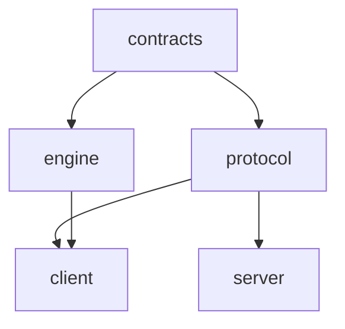
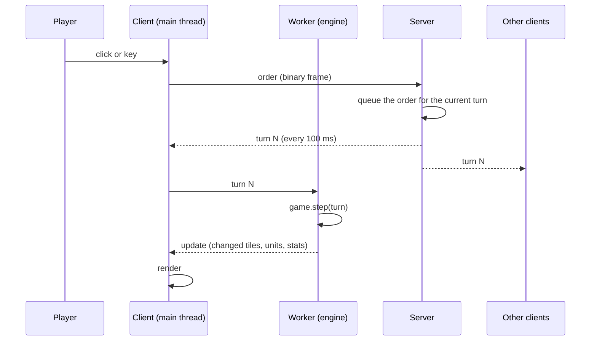
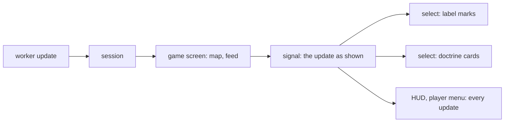

# Architecture guide

This page maps the repository, shows how the layers depend on each other, follows the data from a click to a screen, and gives recipes for the common changes. The decisions behind it are the [architecture decision records](adr/).

The parts describe the code as the proposed records [0006](adr/0006-contracts-package.md) to [0014](adr/0014-enforced-boundaries.md) built it. A part the records name and no pull request builds is marked **Deferred**.

## Repo map

| Path                 | Contents                                                                                                     |
| -------------------- | ------------------------------------------------------------------------------------------------------------ |
| `packages/engine`    | The simulation. Depends on `@frontfall/contracts` only; no clock, no `Math.random` ([engine.md](engine.md)). |
| `packages/protocol`  | Messages, zod schemas, binary frames, shared constants ([protocol.md](protocol.md)).                         |
| `packages/contracts` | The order spec and the constants the engine and the protocol share ([0006](adr/0006-contracts-package.md)).  |
| `apps/server`        | The turn relay: lobbies, rooms, accounts, sign-in, moderation, static files ([server.md](server.md)).        |
| `apps/client`        | The browser game: Three.js rendering, DOM interface, the engine in a Web Worker ([client.md](client.md)).    |
| `tools`              | Repository checks: boundaries, provenance, clean room, map generation.                                       |
| `bench`              | Benchmarks, the performance gate, the balance campaign, load and determinism runs.                           |
| `e2e`                | Playwright tests of the built game.                                                                          |
| `docs`               | Rules, balance, design documents and the records in `docs/adr/`.                                             |

Inside the engine, one file per rule (`attacks.ts`, `diplomacy.ts`, `warships.ts`, `missiles.ts`, `trade.ts` and others), `game.ts` for the state and the turn loop, `orders.ts` and `order-rules.ts` for validation, `state/` (layout, codec, records, parts, lists) with `snapshot.ts` and `snapshot-bytes.ts` for saved state and the hash, `balance.ts` for the numbers, and `bots/` for computer players, nations and city-states.

Inside the client, `game/` runs and follows a game (sessions, the worker, replays), `net/` talks to the server, `render/` draws, `input/` turns gestures into orders, `ui/` holds the screens and panels (`ui/screen/` the parts of the game screen), and `audio/`, `achievements/` and `stats/` are the smaller services. An `app/` folder holds the shell ([0013](adr/0013-client-shell-and-signals.md)), and `main.ts` only starts it.

## Layers and dependency rules

The server does not import the engine: it relays orders and never simulates ([ADR 0001](adr/0001-deterministic-lockstep.md)).

`tools/test/boundaries.test.ts` states these rules ([0014](adr/0014-enforced-boundaries.md)). It enforces the package rules, the absence of runtime cycles in every package and app, owner-only writes of the engine's lists, and the client layer table.

- The contracts import nothing.
- The engine imports `@frontfall/contracts` only.
- The protocol imports zod and contracts.
- The server imports the protocol, zod, nodemailer, `node:*` and `bun:*`.
- The client follows a layer table. `app/` may import anything. `ui/` imports game, render, input, audio, achievements, stats, root files, and `net` for types. `game/` and `net/` import root files. `render/` imports root files. `input/` imports render types. `audio/`, `achievements/` and `stats/` import game types and root files. Root files import root files and `i18n` only. Every layer may import `i18n`, which imports root files only.
- No import cycle at runtime inside a package: a cycle through `import type` only is allowed.
- Only the owning module writes an engine collection ([0010](adr/0010-collection-ownership.md)).

## Data flow

### From an input to every screen

1. The input layer turns a gesture into an `Order`. The client sends it to the server.
2. The server checks the sender and the message, queues the order, and every 100 ms closes the queue into a numbered turn ([ADR 0001](adr/0001-deterministic-lockstep.md)).
3. The server sends the same turn to every client of the room.
4. Each client hands the turn to its worker, which runs `game.step`. The engine validates every order again, so a bad order from the network cannot corrupt a game.
5. The worker posts an update to the main thread, and the renderer draws what changed ([ADR 0003](adr/0003-renderer-split.md)).
6. Clients send a state hash now and then. A mismatch marks a client as out of sync.

In solo mode and in replays, the client plays the server's part itself, in the same code path.

### From an update to a panel

The session hands each update to the game screen, which takes it into the map first (the feed reads what the update took before the map does), then writes it into a signal ([0013](adr/0013-client-shell-and-signals.md)). Each panel subscribes through `select(signal, pick, equals)` (`apps/client/src/signals.ts`), so it redraws only when what it shows changes. The worker protocol is unchanged.

## Pattern catalog

| Pattern                           | Where it is used                                                                                  | Status |
| --------------------------------- | ------------------------------------------------------------------------------------------------- | ------ |
| Deterministic lockstep            | The whole game ([0001](adr/0001-deterministic-lockstep.md))                                       | Today  |
| `Topology` interface              | Every geometry call in the engine ([0002](adr/0002-topology.md))                                  | Today  |
| `Renderer` and `Camera`           | Map and globe drawing ([0003](adr/0003-renderer-split.md))                                        | Today  |
| One rule per file, `installX`     | The engine rules, installed by `createGame`                                                       | Today  |
| Observers (`onApplied`)           | Nations hear of orders                                                                            | Today  |
| One order spec                    | Contracts, protocol and engine share it ([0006](adr/0006-contracts-package.md))                   | Today  |
| Order registry                    | `defineOrder`: phases, validate, plan, execute ([0007](adr/0007-order-dispatch.md))               | Today  |
| Rule-owned parts, codecs          | State of a rule, snapshot and hash from one description ([0008](adr/0008-rule-state-and-hash.md)) | Today  |
| Rule table                        | `STANDARD_RULES` ([0009](adr/0009-rule-table-and-lifecycles.md))                                  | Today  |
| Derived lifecycles                | `structureState`, `allianceState`, `warshipState` ([0009](adr/0009-rule-table-and-lifecycles.md)) | Today  |
| Owner functions                   | Cross-rule changes to a collection ([0010](adr/0010-collection-ownership.md))                     | Today  |
| Ports and fakes                   | Server clock, ids, transport, stores ([0012](adr/0012-server-ports-and-stores.md))                | Today  |
| Room transition table, outbox     | Server rooms ([0012](adr/0012-server-ports-and-stores.md))                                        | Today  |
| App state machine                 | Client screens kept in step with the URL ([0013](adr/0013-client-shell-and-signals.md))           | Today  |
| Sessions with capabilities        | Solo, Online, Replay ([0013](adr/0013-client-shell-and-signals.md))                               | Today  |
| Signals with `select`             | Client panels ([0013](adr/0013-client-shell-and-signals.md))                                      | Today  |
| Boundary tests on the syntax tree | `tools/test/boundaries.test.ts` ([0014](adr/0014-enforced-boundaries.md))                         | Today  |

## How to add

Each recipe gives the steps that work today. Every engine change comes with tests that cite the rule identifiers it implements, and a change that alters play rebuilds the golden replays as described in [CONTRIBUTING.md](../CONTRIBUTING.md).

### An order

Today:

1. Add the member to the `Order` union in `packages/contracts/src/orders.ts`, with a doc comment.
2. Append the kind to `ORDER_SPEC` there, with the kind of each field. Append only: the position is the code on the wire. The protocol builds its schema and its frames from it.
3. Write its rule with `defineOrder(type, { phases, validate, execute })` next to the rule's `installX` function, register it there with `game.onOrder`, and list it in `ORDER_RULES` in `packages/engine/src/orders.ts`. `validate` returns the refusal or a plan that `execute` carries out.
4. Check that `createGame` still starts: it refuses a type with no rule.
5. Raise `PROTOCOL_VERSION` in `packages/protocol/src/messages.ts`, and add a frame to the pinned frames in `packages/protocol/test/binary.test.ts`.
6. Describe it in [engine.md](engine.md) and [protocol.md](protocol.md).

Every check goes in `validate`: `execute` cannot refuse a plan ([0007](adr/0007-order-dispatch.md)). **Deferred**: eleven of the 17 kinds use `ANY_PHASE` and keep their phase check in `validate`, so that their refusal strings stay the same; moving it into `phases` is left out of this series.

### A rule and its state

Write `packages/engine/src/<rule>.ts` with an `installX(game)` function and add an entry to `STANDARD_RULES` in `create-game.ts` after the rules it reads from. Keep the rule's state in a part of its own ([0008](adr/0008-rule-state-and-hash.md)): a `partKey` in the module, and a `PlayerValues`, `SlotValues` or `RecordList` from `packages/engine/src/state/parts.ts` registered with `game.addPart` by the install function, only in games that play with the rule, with a codec field for its values. Export an accessor that reads it. Never add a field to `Game` or to an entity. The snapshot and `game.hash()` then carry the part with nothing more to write; bump `SNAPSHOT_FORMAT`, add its values to `test/state-coverage.test.ts` and to the state dump, and rebuild the golden replays. Other rules change your collections through functions you export ([0010](adr/0010-collection-ownership.md)). Name the rule identifiers in the code and the tests.

### A balance value

1. Add the key to the `Balance` type and to `DEFAULT_BALANCE` in `packages/engine/src/balance.ts`, in the units the engine uses.
2. Document it in [balance.md](balance.md) with its `B-` identifier.
3. Add the key to `BALANCE_SPEC` in the same file with its range, or `"unchecked"`, and, if it matters only under a rule or a map feature, the digest gate that keeps the digest the same when that feature is off ([0009](adr/0009-rule-table-and-lifecycles.md)). The compiler refuses a key without an entry.
4. Rebuild the golden replays, because the value is part of the balance digest.

### A nation strategy

Nations live under `packages/engine/src/bots/nations/` ([0009](adr/0009-rule-table-and-lifecycles.md)): `decide.ts` runs the phases of a decision in order, and every phase takes the one `NationContext` of its call to `installNations` (`context.ts`). Add the name to `NationStrategy` in `bots/difficulty.ts`, give it a place in the difficulty tables, and implement it in `NATION_STRATEGIES` (`strategies.ts`), as a function of the context and the turn's `NationTurn`; the compiler refuses a strategy without one. Draw randomness only from the game's `Random`, and keep the order of draws stable, since a change moves every nation game.

### A screen

Write the screen in `apps/client/src/ui/`, build the DOM with the helpers in `dom.ts`, and add a state for it to the app state machine (`apps/client/src/app/state.ts`) with its address in `app/address.ts`; the app shows it through its `ScreenHost` ([0013](adr/0013-client-shell-and-signals.md)). Strings go through `i18n` in English and French. A panel inside the game reads its data through `select(signal, pick, equals)`.

### A server message

1. Add the message to the zod schemas in `packages/protocol/src/messages.ts` and, if it travels often, to the binary codec.
2. Add the handler in `apps/server/src/client-messages.ts` (for a message from a client) or send it from the room.
3. Handle it in `apps/client/src/net/`.
4. Raise `PROTOCOL_VERSION` if old clients cannot understand it, and update [protocol.md](protocol.md); a test in `tools/test/protocol-doc.test.ts` checks that the document and the code agree.

The handler is an entry in the typed `Handlers` map ([0012](adr/0012-server-ports-and-stores.md)), and its test drives it through the `FakeTransport` with the `FakeClock`.

### A store

A store is a class over the `SqlDriver` port (`apps/server/src/sql/driver.ts`), with its table in the schema of `apps/server/src/database.ts`, a one-time import in `import-json.ts` if it replaces a file, and a command in `frontfall-admin` (`admin-command.ts`) if an operator needs to change it by hand; `moderation.ts` is a good model. Its test runs on `node:sqlite` under Vitest; production runs `bun:sqlite`. Personal data goes in `data.db`, readable by the server's user only, and [privacy.md](privacy.md) says what it holds.

### A map

Maps are generated from public-domain data by `bun run maps` ([maps.md](maps.md)) in the format of [map-format.md](map-format.md). Add the source and its settings to the generator in `tools/src/mapgen`, run it, and check that the published-maps test passes. List new data sources in [CREDITS.md](../CREDITS.md). A map with a new feature that changes play must say which balance digest gate it needs.
